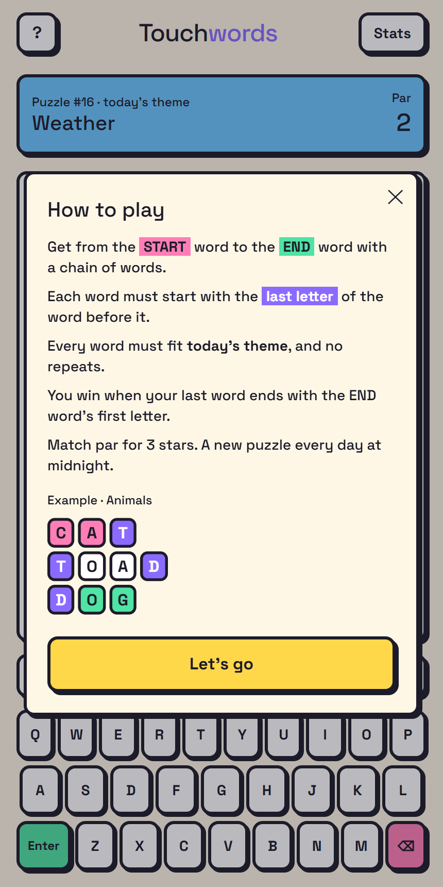
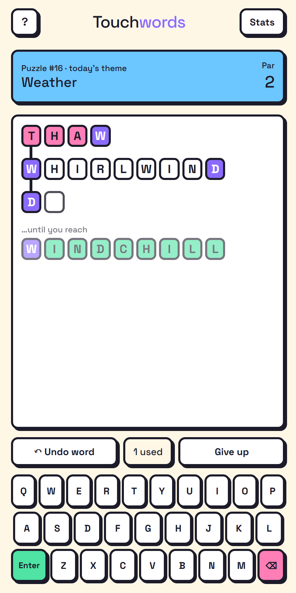
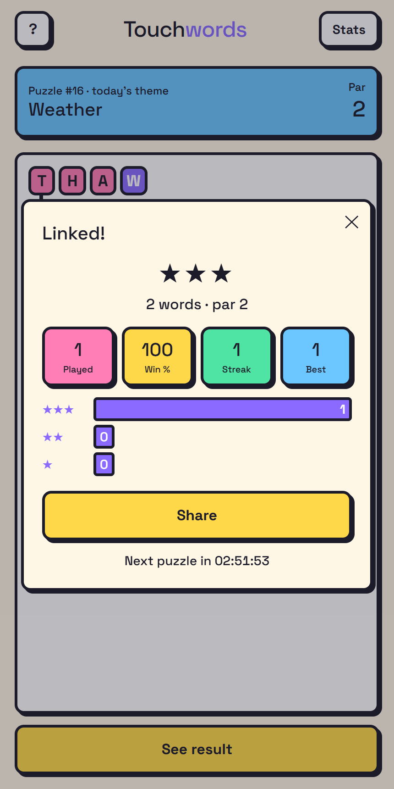

# Touchwords

A free daily word-chain puzzle. You get a **start** word and an **end** word. Build a chain of words from one theme (Animals, Weather, …) where each word starts with the last letter of the one before it. Link the start to the end in as few words as you can: match par for 3 stars. One puzzle a day, same for everyone, no signup.

<p>
  
  
  
</p>

## Stack

React 19 + Vite + Tailwind 4, deployed on Vercel (`api/today.js` is the serverless function). Tests use Vitest.

## Develop

```bash
npm install
npm run dev      # http://localhost:5173, /api/today?day=N previews any day
npm test
npm run build
```

## How it works

- `src/game.js` – pure rules (word check, shortest-path `solve`, stars), shared by the app and generator.
- `src/daily.js` – countdown, streak/stats, localStorage helpers.
- `server/` – owns the calendar (`days.json`) and the clock; `getPuzzle` never sends the solution until the game is over.
- `data/` – theme word lists (`themes.mjs`, `more.mjs`, WordNet expansion in `wordnet.json`) and `probes.mjs` (words that must be rejected, used by tests).
- `scripts/build-puzzles.mjs` – `npm run puzzles` regenerates `src/themes.json` and `server/days.json` from `data/`.
- `scripts/wordnet.py` – one-off (`pip install nltk wordfreq`) to refresh `data/wordnet.json`.
